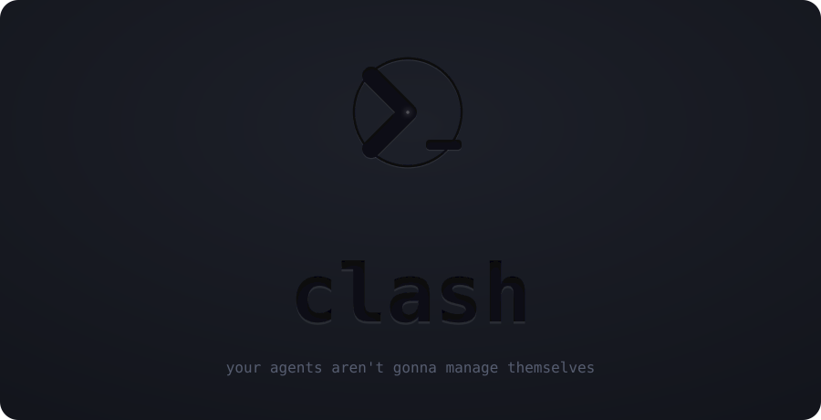

<p align="center">
  
</p>

<p align="center">
  <strong>Desktop app & terminal UI for Claude Code sessions, agent teams and dev workflows</strong>
</p>

<p align="center">
  <a href="#installation">Install</a> &bull;
  <a href="#quick-start">Quick start</a> &bull;
  <a href="#the-desktop-app">Desktop app</a> &bull;
  <a href="#workflows">Workflows</a> &bull;
  <a href="#terminal-ui-tui">TUI</a> &bull;
  <a href="#documentation">Docs</a>
</p>

---

clash manages every Claude Code and [OMP](https://omp.sh) (oh-my-pi) agent
session on your machine from one place: it lists them with live status, starts,
attaches, stashes, resumes and kills them, and takes over `claude` processes
started elsewhere. On top of that it runs **Workflows** — one item per piece of
work, taken from plan to code to PR by agents, with you approving each step.
The desktop app (GUI) is the primary way to use clash; the terminal UI (TUI) is
the terminal-native fallback, backed by the same core.

## Features

- **One place for every agent session** — Claude Code and OMP sessions grouped
  by status, with live three-layer status detection (hooks, PTY screen
  analysis, transcripts). [Sessions](docs/sessions.md)
- **Two frontends, one core** — the desktop **GUI** (Tauri) and a
  keyboard-driven **TUI**, both backed by the same in-process PTY daemon;
  several instances can run side by side.
- **Desktop workspace** — cmux-style workspaces, freely nested drag-to-split
  panes, GPU-rendered terminals, shell terminals, embedded browser tabs, 12
  themes, and a layout restored exactly on relaunch.
- **Workflows** — plan → review → implement → diff review → (optional) PR, with
  line comments, repeatable agent review rounds, explanations, a suggested next
  step, multi-repo PRs, ticket links and sharing to Slack, Discord, Jira or
  Linear.
- **Attention inbox** — one ordered list (`⌘I`) of everything waiting on you.
- **Files panel** — a git-aware file explorer with fuzzy find and previews.
- **Queued follow-ups** — type the next instruction while an agent works; clash
  delivers it once the session is idle, never to a tool-approval question.
- **Takeover of outside sessions** — `claude` processes started elsewhere show
  up as 🌿 Wild rows; one confirm moves their conversation under clash.
- **Git worktrees** — start a session in an isolated worktree; diffs, PR
  detection and *open in IDE* (Cursor, VS Code, Zed, JetBrains, vim…) per
  session.
- **Teams & tasks** — create and edit Claude Code agent teams, members, tasks
  and per-agent inboxes.
- **Scratches** — an IntelliJ-style tree of free-form notes and folders.
- **Session presets** — reusable directory / worktree / prompt / setup-script
  templates, per project or global (Superset-compatible).
- **Layered configuration** — one `config.toml` shared by both frontends, with
  project and env overrides and live reload.
- **Self-updating** — a background release check, and one click (or
  `clash update`) to update both binaries in place.

## Installation

### Quick install (Linux / macOS)

```bash
curl -fsSL https://raw.githubusercontent.com/defgenx/clash/main/install.sh | bash
```

This installs the **TUI** (`clash`) from the latest release. For the GUI, build
from a clone with `make install` (below).

Custom install path:

```bash
CLASH_INSTALL_DIR=~/.local/bin curl -fsSL https://raw.githubusercontent.com/defgenx/clash/main/install.sh | bash
```

### Build from source

```bash
cargo install --git https://github.com/defgenx/clash.git   # the TUI only
```

Or from a clone — installs **both** the TUI and the GUI (override paths with
`INSTALL_DIR=~/.local/bin` / `APP_DIR=~/Applications`):

```bash
make install            # or: make install-tui / make install-gui
```

The TUI installs as the `clash` binary in `INSTALL_DIR`. The GUI installs as a
regular desktop application, discoverable like any other app:

- **macOS** — `Clash.app` in `/Applications` (falls back to `~/Applications`
  when not writable): Spotlight, Launchpad, Dock. A `clash-gui` symlink lands in
  `INSTALL_DIR` for terminal launching.
- **Linux** — `clash-gui` binary plus an XDG `clash.desktop` launcher entry and
  icon (system-wide under `/usr/local/share` as root, per-user under
  `~/.local/share` otherwise).

### Requirements

- Claude Code CLI (`claude`), and/or OMP (`omp`, oh-my-pi) for OMP sessions
- `git` (worktrees, diffs) and, for every PR feature, the GitHub CLI `gh`
- Building from source: a recent stable Rust (1.82+); for the GUI on Linux, the
  webkit2gtk / GTK development packages (see
  [development.md](docs/development.md#building))

## Quick start

1. Launch **Clash** from your applications (or run `clash-gui`). The first
   launch opens a guided tour; replay it from *Settings → General → ▶ Show the
   tour*.
2. Press `⌘T` (**＋ New session**), pick a directory, optionally a preset or a
   git worktree, and the agent (Claude Code or OMP).
3. Your existing sessions are already in the sidebar, grouped by status. Click
   one to open it; closing its tab stashes it, and it resumes on the next
   click.
4. `⌘D` splits the pane, `⌘N` starts a new workspace, `⌘I` shows what needs
   you, and `⌘,` opens the settings.
5. For a piece of work you want planned, reviewed and turned into a PR, press
   `+` on the WORKFLOWS section (see [Workflows](#workflows)).

At every launch, clash (re)writes its lifecycle hooks to `~/.claude/clash/hooks/`
and passes them to every session it spawns (`claude --settings …`), so it
registers nothing in your own settings files — see [hooks.md](docs/hooks.md).

### Command line

```bash
clash-gui                          # Start the GUI
clash                              # Start the TUI (reads from ~/.claude)
clash --data-dir ~/.claude         # Custom data directory
clash --claude-bin /path/to/claude # Custom CLI path
clash --debug                      # Enable debug logging
clash update                       # Update clash and clash-gui to the latest release
clash config [--path|--defaults|--validate|--schema]   # Inspect configuration
clash attach <session-id>          # Attach to a session owned by a running clash (used by external panes)
clash daemon                       # Run the session daemon standalone (normally in-process)
clash --version
```

## The desktop app

The full guide, with every shortcut, is [docs/gui.md](docs/gui.md).

### Workspaces, panes and tabs

Each **workspace** owns a pane layout and its sessions (`⌘N` new, `⌘1–9`
switch). Panes split freely (`⌘D`) and rearrange by dragging a tab onto the
half of a pane where the split should open. Every tab — agent session, shell,
browser, workflow item, inbox — belongs to one workspace. On relaunch clash
restores workspaces, tabs, layout and browser tabs.

### Sessions

The sidebar groups sessions by status (PROMPTING, THINKING, RUNNING, WAITING,
STARTING, STASHED, ERRORED, DONE), with a **CC** / **OMP** badge on every row.
Each row's `⋯` menu renames, ⟳ reloads (hot-restarts on the newest `claude`
binary), stashes, kills, queues a follow-up or opens the PR. A `claude` started
outside clash appears under `⚡ EXTERNAL` as a 🌿 Wild session; clicking it takes
it over after one confirm. How status and wild detection work:
[docs/sessions.md](docs/sessions.md).

### Terminals and browser

Terminals are xterm.js with WebGL rendering. `⌘⇧T` opens a shell terminal;
⌥-drag selects text while Claude Code holds the mouse; dropping a file types
its path. Browser tabs (`⌘⇧B`) are first-class tabs with full chrome, and one
setting decides whether links open in clash or the system browser.

### Files

The **Files** panel (`⌘E`) shows the focused session's folder with git status
on every file, fuzzy find (`⌘P`), syntax-highlighted / Markdown / image
previews, and *Mention in session* to type `@path` into the agent.
[Details](docs/gui.md#files).

### Scratches, teams and inbox

- **Scratches** — a tree of notes and folders under `~/.claude/clash/scratch/`,
  reorganized by drag and drop and opened in your editor of choice.
- **Teams** — Claude Code agent teams with live running counts; edit members
  and tasks, and jump from a running member to its session.
- **Attention inbox** (`⌘I`) — blocked tool calls, dead workflow agents,
  errors, parked decisions, unanswered PR threads and finished turns, in that
  order.

### Layouts, settings and updates

Pick how the window is arranged in *Settings → Appearance → Layout*: **Classic**
(one sidebar, collapsible sections), **Focus** (one section open at a time),
**Rail** (an icon rail for workspaces and views, one full-height panel) or
**Flyout** (the rail alone; views slide over the terminals). Same features in
each — see [docs/gui.md → Layouts](docs/gui.md#layouts).

`⌘,` (or **⚙ All settings…** in the sidebar) opens the Settings window, with
tabs for General, Appearance, Terminal, Paths, Workflows, Models and Trackers &
sharing, and a search box over every tab. The sidebar's SETTINGS panel keeps
the quick settings (theme, layout, font size, how links open, default agent)
and the **⟳ Update clash** button.

clash checks for a new release at startup and every 6 hours
(`general.update_check`, on by default). A release found is announced with a
toast and the footer's version label becomes an update button; nothing
installs until you click.

## Workflows

A Workflow item takes one piece of work from idea to merged PR by Claude Code
or OMP agents, with you approving every step. Everything is plain files under
`~/.claude/clash/workflows/`, so an item's history stays readable outside
clash. Workflows are GUI-only.

- **Three ways in**: a full workflow from an idea, from a plan you already
  have, or review-only on an existing PR or branch.
- **The pipeline**: `draft → planning → plan-review → changes-requested →
  implementing → diff-review → pr-draft → pr-ready → done`, plus `abandoned`
  and `reviewing` while an agent review round runs. The PR stages are
  optional.
- **Your review**: line comments on the diff, and a change-request composer
  whose note becomes the next agent round's prompt.
- **Agent review rounds**: plan reviews, code reviews and plan-vs-changes
  comparisons are side trips — the item goes to `reviewing` and comes back
  where it started, so you can run as many as you like. Findings land as diff
  comments and in `agent-review.md`; one click applies a round as the next
  change round.
- **Explanations**: a written walk-through and a drawing of what the plan will
  do or what the change did, as a tree you can zoom into part by part.
- **Self-review**: a reviewer that reads the PR and its whole discussion, then
  posts an approve or request-changes review.
- **Suggested next step** on every item, with an optional autopilot for the
  checks that post nothing.
- **Pull requests**: draft PRs written through your org's PR skill, multi-repo
  items with linked PRs, PR stacks and a PR dashboard.
- **Trackers and sharing**: Jira and Linear side by side, keys routed by prefix,
  so agents link every ticket they mention; one composed document to the
  clipboard, `.md` / `.html`, Slack, Discord, or a Jira or Linear ticket.

The agent side is six skills embedded in the binary and installed at startup:
`clash-workflow` (the executor), `clash-plan-review`, `clash-code-review`,
`clash-explain`, `clash-drift-review` (plan vs changes) and `clash-pr-review`
(the self-review, also usable on any PR with `/clash-pr-review`).

The user guide is [docs/workflows-guide.md](docs/workflows-guide.md); the file
contract the agents follow is [docs/workflows.md](docs/workflows.md).

## Terminal UI (TUI)

`clash` starts the terminal UI: the same sessions, teams, tasks, scratches and
presets, driven from the keyboard and usable over SSH. Workflows, workspaces,
the browser, the Files panel and the inbox are GUI-only.

| Key | Action |
|---|---|
| `j` / `k` · `Enter` · `Esc` | move · drill in · go back |
| `a` | attach to a session (`Ctrl+B` detaches); on a 🌿 wild row, take it over |
| `n` | new session |
| `s` / `d` | stash / drop a session |
| `o` / `O` | open one / all running sessions in panes or tabs of your terminal |
| `f` | queue a follow-up prompt |
| `:` · `/` · `?` | command mode · fuzzy filter · help |

The full key and command reference is [docs/tui.md](docs/tui.md).

## Configuration

One `config.toml`, shared by both frontends, merged over in-code defaults and
under a restricted `<repo>/.clash/config.toml` and `CLASH_*` environment
overrides. Edits apply live.

```bash
clash config            # the merged config, annotated with where each value came from
clash config --path     # where the file is
clash config --defaults # every key with its default
```

Every key and the layering rules: [docs/config-file.md](docs/config-file.md).

## Documentation

| Document | What it covers |
|---|---|
| [docs/gui.md](docs/gui.md) | The desktop app in full: panes, sessions, terminals, browser, files, scratches, teams, inbox, settings, shortcuts |
| [docs/workflows-guide.md](docs/workflows-guide.md) | Workflows from the user's side, including ticket trackers and sharing |
| [docs/tui.md](docs/tui.md) | Every TUI keybinding and command |
| [docs/sessions.md](docs/sessions.md) | Status detection, session sources, wild sessions, OMP sessions, presets |
| [docs/config-file.md](docs/config-file.md) | The configuration file and every key |
| [docs/data.md](docs/data.md) | Every file clash reads and writes |
| [docs/workflows.md](docs/workflows.md) | The workflow file contract for agents and skills |
| [docs/configuration.md](docs/configuration.md) | Configuration internals |
| [docs/hooks.md](docs/hooks.md) | Status hooks and the OMP status extension |
| [docs/development.md](docs/development.md) | Building, testing, architecture |

The index is [docs/README.md](docs/README.md).

## Development

```bash
cargo build --release               # builds both binaries: clash and clash-gui
cargo test --all-targets            # Rust tests
node --test "gui/tests/*.test.js"    # GUI frontend tests
cargo clippy -- -D warnings         # Lint (as CI runs it)
cargo fmt --check                   # Formatting
```

Releases are automatic — push with conventional commits (`feat:`, `fix:`) and
CI handles the rest. Architecture and build details:
[docs/development.md](docs/development.md).

## License

MIT
